<div align="center">

# NowPlayingJellyfin

**A tiny pixel-art companion for your Jellyfin server.**

It shows what's playing on a 3.5" Raspberry Pi screen, and when nothing is,
a little monster hangs out, makes faces, and eventually gets drowsy.

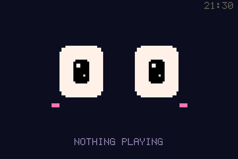


[Features](#features) · [Gallery](#gallery) · [What you need](#what-you-need) · [Install](#install-in-3-steps) · [Usage](#usage) · [Troubleshooting](#troubleshooting) · [Security](#security) · [Make your own theme](#make-your-own-theme)

</div>

---

## Features

- **Now Playing screen**: poster, title, season/episode, who's watching and on which device, plus a chunky progress bar that moves smoothly between updates.
- **An idle monster with 16 expressions**: happy, angry, sad, sleepy, in love, dizzy, suspicious, and more. It blinks and looks around on its own, and it **reacts to what happens**:
  - it gets sad when a movie ends,
  - it gets dizzy if Jellyfin goes offline,
  - it gets sleepy late at night,
  - after 4 hours with nothing playing it gets drowsy: half-closed eyes, nodding off and jolting
    back awake. You choose how long with `sudo display sleep`, or turn it off.
- **10 themes, 6 of them animated**: a synthwave road, a fish tank, a haunted graveyard, a snowy Christmas night, a rainy cyberpunk city, a retro 90s desktop… and one hidden one.
- **Control everything from the terminal**: `sudo display miami` switches the theme in about a second,
  and the language, sleep timer and screen rotation work the same way. No restart, no config files,
  and **TAB autocompletes** every command.
- **English and Portuguese** on-screen text: `sudo display lang pt`.
- **One-command install**, which also sets up the screen driver for you.
- **Lightweight and safe**: pure Python (Pillow + numpy), drawing straight to the framebuffer. No desktop, no X, no pygame. It runs as an unprivileged, sandboxed service and uses a few % of a Pi 3's CPU.

---

## Gallery

### All the themes

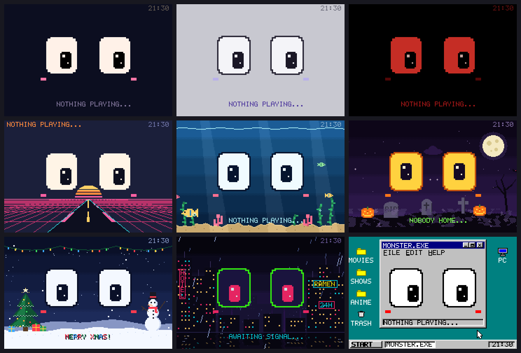

When something is playing, each theme restyles the Now Playing screen:

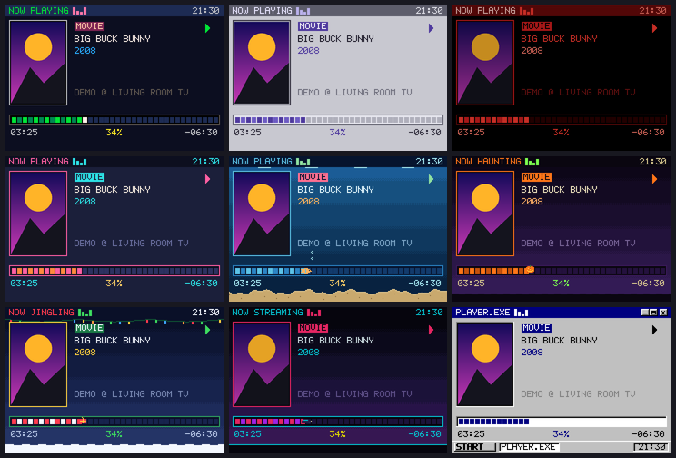

### The animated ones

| `miami`: synthwave road | `aquarium`: fish, bubbles, seaweed |
|:---:|:---:|
| 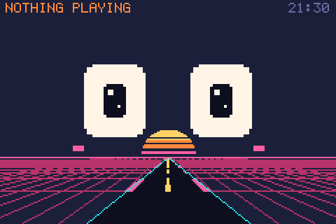 | 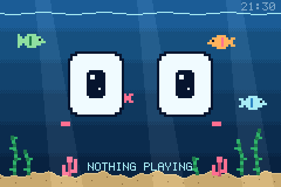 |
| **`halloween`**: bats, fog, a ghost | **`christmas`**: snow, lights, a waving snowman |
| 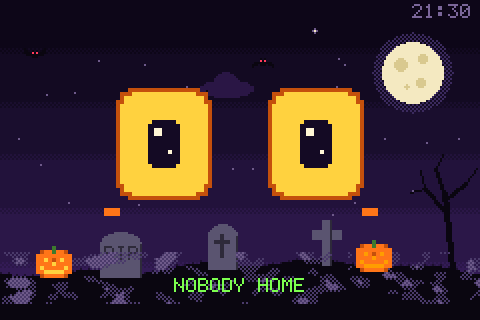 | 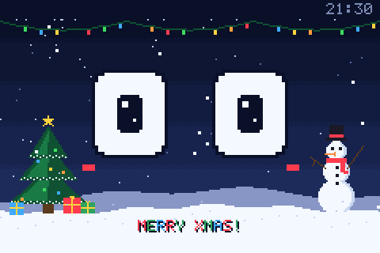 |
| **`cyberpunk`**: rain, neon, hover cars, glitches | **`win95`**: the eyes follow the mouse cursor |
| 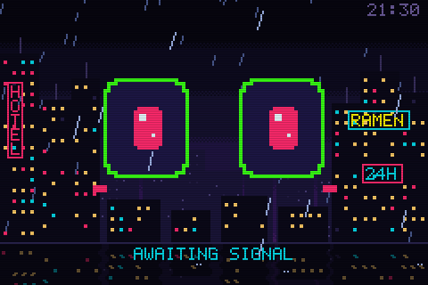 | 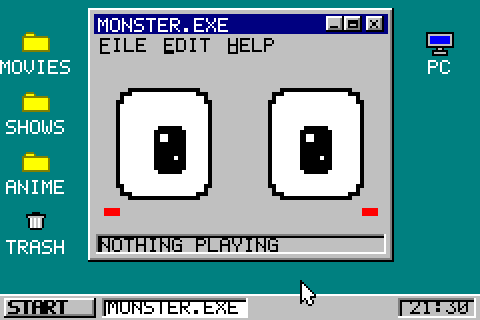 |

### Every expression

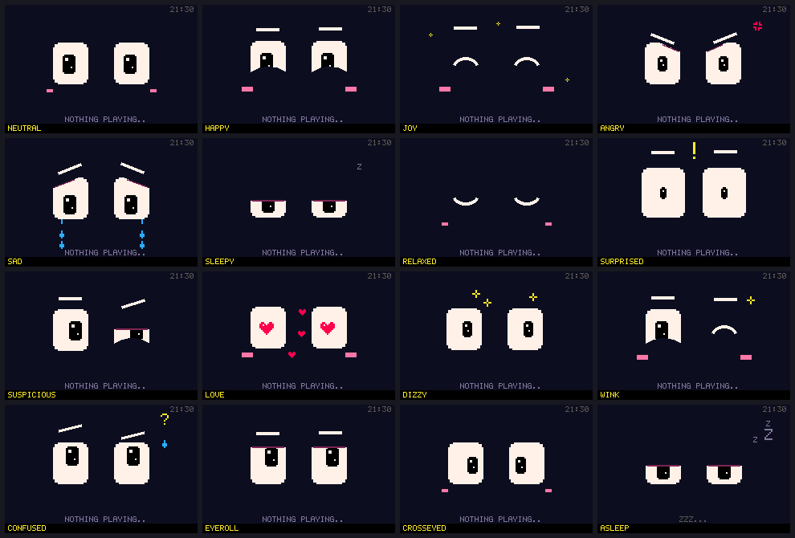

### Now Playing

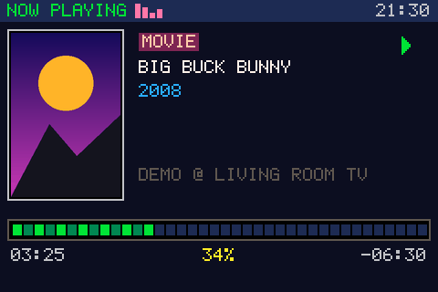

> In the `aquarium`, `halloween`, `christmas`, `cyberpunk` and `win95` themes, a little character (a fish, a pumpkin, a gift, a hover car) rides the progress bar.

---

## What you need

| | |
|---|---|
| **Raspberry Pi** | Any model with the 40-pin header. Developed and tested on a **Pi 3 B+**. |
| **Screen** | A **3.5" SPI LCD, 480×320, ILI9486 controller** (the touch chip, usually XPT2046, isn't used). These are the cheap ones that plug right onto the Pi's pins. They're often sold as *"3.5 inch RPi LCD (A)"*, *"MPI3501"* or *"Waveshare 3.5" (A)"* clones. |
| **OS** | A Debian-based system with systemd: **Raspberry Pi OS** (Bookworm or newer) or **DietPi**. Lite/headless is perfect. |
| **Jellyfin** | Any recent Jellyfin server. It can run **on the same Pi** (bare metal or Docker) **or on another machine** on your network. |

> **Plugging in the screen:** with the Pi **off**, push the screen onto the **first 26 pins**, lined up with **pin 1**, the corner next to the SD card slot. Shifting it by one row is the #1 cause of a blank white screen.

---

## Install (in 3 steps)

### 1. Create a Jellyfin API key

In the Jellyfin web interface, go to **Dashboard → API Keys** (under *Advanced*), then click **+**. Name it `nowplaying` and copy the key it gives you. You'll paste it in step 2.

### 2. Run the installer on your Pi

SSH into the Pi and paste this:

```bash
curl -fsSL https://raw.githubusercontent.com/WPNTL/NowPlayingJellyfin/main/install.sh | sudo bash
```

It asks you a few questions. Pressing **Enter** accepts the default in brackets.

```text
==> 3/5  Screen driver (3.5" ILI9486 SPI LCD)
    1) piscreen      (recommended)
    2) waveshare35a
    3) skip          (I'll set it up myself)
  Pick one [1]:

==> 4/5  Connecting to Jellyfin
  ✓ found server "MyJellyfin" at http://127.0.0.1:8096
  API key:                         ← paste it (hidden) and press Enter
  ✓ API key works
  On-screen language: en (English) / pt (Português) [en]:
```

<details>
<summary><b>Prefer to read a script before running it as root?</b> (good habit!)</summary>

```bash
curl -fsSLO https://raw.githubusercontent.com/WPNTL/NowPlayingJellyfin/main/install.sh
less install.sh          # read it
sudo bash install.sh
```

Or clone the whole repo:

```bash
git clone https://github.com/WPNTL/NowPlayingJellyfin.git
cd NowPlayingJellyfin
sudo ./install.sh
```

</details>

### 3. Reboot

The installer offers to reboot at the end, because the screen driver loads at boot. About a minute later, **the monster says hi**.

Play something in Jellyfin (TV, phone, browser…). Within 2 seconds the screen switches to the poster and progress bar.

<details>
<summary><b>What exactly does the installer do?</b></summary>

1. Installs `python3`, `python3-pil`, `python3-numpy` and `bash-completion` with `apt`.
2. Copies the app to `/opt/nowplaying` and creates the `display` command, with TAB completion.
3. Adds the screen driver to `/boot/firmware/config.txt` (or `/boot/config.txt`). It **backs the file up first**, and the lines it adds are wrapped in `# >>> nowplaying lcd >>>` markers so they can be removed cleanly. It skips this step if your screen already works.
4. Finds your Jellyfin server and **tests your API key before saving it**. It saves the settings to `/etc/nowplaying/nowplaying.env` with **root-only** permissions.
5. Creates a locked-down `nowplaying` system user and a sandboxed systemd service.

Running it again is safe. It updates the app and keeps your settings.

</details>

<details>
<summary><b>Unattended install</b> (for scripts or Ansible)</summary>

Every question can be answered with an environment variable:

```bash
curl -fsSL https://raw.githubusercontent.com/WPNTL/NowPlayingJellyfin/main/install.sh | \
  sudo JELLYFIN_URL=http://127.0.0.1:8096 JELLYFIN_API_KEY=xxxx \
       LCD_OVERLAY=piscreen NP_LANG=en ASSUME_YES=1 bash
```

`LCD_OVERLAY` can be `piscreen`, `waveshare35a` or `skip`. Without a terminal, the installer never reboots on its own unless `ASSUME_YES=1` is set.

</details>

---

## Usage

Everything goes through the `display` command:

| Command | What it does |
|---|---|
| `display` | Shows the current settings (theme, language, sleep timer, rotation) |
| `display list` | Lists the themes, with color swatches |
| `sudo display <theme>` | Switches the theme, e.g. `sudo display cyberpunk`. Takes about 1 second. |
| `sudo display lang en` / `pt` | Switches the on-screen language |
| `sudo display sleep <time>` | How long with nothing playing before the monster gets drowsy. Default `4h`. Examples: `30m`, `2h`, `1h30m`, `off` (never). |
| `sudo display rotate <deg>` | Rotates the image: `0`, `90`, `180` or `270`. Use `180` if it's upside down. |
| `sudo display restart` | Restarts the service (do this after editing settings) |
| `sudo display logs` | Shows the last 30 log lines, which is the first stop when something's off |
| `display help` | Shows the built-in help |

Theme, language, sleep timer and rotation apply in about a second and are remembered across reboots.

**TAB completion:** type `display ` (or `sudo display `) and press **TAB** to see every command and
theme. It also completes values, like `sudo display sleep <TAB>`. It works in any terminal opened after
the install.

### Themes

| Theme | Vibe |
|---|---|
| `pico` | The original look, in the PICO-8 palette. **Default.** |
| `snes` | Light gray and purple, like a certain 90s console |
| `atari` | Red on black, with CRT scanlines |
| `miami` | Neon sunset and a synthwave road rushing toward you |
| `aquarium` | Fish swimming behind the eyes, bubbles, seaweed, light rays |
| `halloween` | Moonlit graveyard, bats, fog, flickering jack-o'-lanterns, a ghost |
| `christmas` | Falling snow (some flakes land in front of the eyes!), a tree with chasing lights, a waving snowman, a sleigh |
| `cyberpunk` | A rainy neon city, wet-street reflections, hover cars, an ad blimp showing your server's name, random glitches |
| `win95` | Teal desktop with beveled windows. The monster lives in `MONSTER.EXE`, its eyes follow the mouse cursor, and funny error popups show up (the cursor goes and clicks OK). |

> There's also one hidden theme. Hint: it's a four-letter classic shooter. Typing its name a second time gets you out.

---

## Configuration

Most people never need this section: the theme, language, sleep timer and rotation are all set with the
`display` command (see [Usage](#usage)). The connection settings and a few extras live in
`/etc/nowplaying/nowplaying.env`. Edit them with:

```bash
sudo nano /etc/nowplaying/nowplaying.env
sudo display restart
```

| Variable | Default | What it's for |
|---|---|---|
| `JELLYFIN_URL` | `http://127.0.0.1:8096` | Where Jellyfin is |
| `JELLYFIN_API_KEY` | *(required)* | The key from the install steps |
| `NP_LANG` | `en` | `en` or `pt` (`display lang` overrides it) |
| `NP_THEME` | `pico` | Theme used before `display` is ever run |
| `NP_ROTATE` | `0` | Starting rotation (`display rotate` overrides it) |
| `NP_SLEEP_MIN` | `240` | Starting sleep timer in minutes, `0` = never (`display sleep` overrides it) |
| `NP_FPS` | `6` | Frames per second. Only raise it if you also raise the SPI speed (see below). |
| `NP_PIXEL_POSTER` | *(off)* | Set to `1` for a crunchy 8-bit poster in the theme's palette |
| `FB_DEVICE` | *(auto)* | Force a framebuffer, e.g. `/dev/fb1` |

<details>
<summary><b>Smoother animations (optional)</b></summary>

The screen runs over SPI at 16 MHz, which is good for about 6 full frames per second. Many boards also handle 32 MHz. Change `speed=16000000` to `speed=32000000` in your `config.txt`, set `NP_FPS=10`, and reboot. If the screen goes white, go back to 16 MHz.

</details>

---

## Troubleshooting

<details>
<summary><b>The screen is completely white</b></summary>

A white screen means the backlight is on but **no driver has started the display**.

1. Check whether the driver loaded:
   ```bash
   cat /sys/class/graphics/fb*/name     # you want to see fb_ili9486 in the list
   ```
2. If it's not there, check that the screen sits on the **first 26 pins, aligned with pin 1**.
3. Re-run the installer and pick the **other** driver (`waveshare35a` instead of `piscreen`, or the other way around). Remove the old `# >>> nowplaying lcd >>>` block from `config.txt` first, or the installer will think it's already set up.
4. Quick hardware test, which should fill the screen with colorful noise:
   ```bash
   sudo sh -c 'cat /dev/urandom > /dev/fb1'     # "No space left on device" at the end is normal
   ```

</details>

<details>
<summary><b>It says "NO CONNECTION"</b></summary>

Run `sudo display logs`. The exact error is in there.

- `Connection refused` means Jellyfin isn't at that address or port. The default Jellyfin port is **8096**. If you run Jellyfin in Docker, check the published port with `docker ps`.
- `HTTP Error 401` means the API key is wrong or was deleted. Create a new one and put it in `/etc/nowplaying/nowplaying.env`.

Test from the Pi itself:

```bash
curl http://127.0.0.1:8096/System/Info/Public     # should print some JSON with your server name
```

</details>

<details>
<summary><b>The image is upside down</b></summary>

```bash
sudo display rotate 180
```

</details>

<details>
<summary><b>The clock is wrong</b></summary>

The Pi is probably on UTC. Set your timezone, then restart:

```bash
sudo timedatectl set-timezone America/New_York     # yours here
sudo display restart
```

</details>

<details>
<summary><b>Terminal text flickers on top of the drawing</b></summary>

The Linux console is also drawing on the LCD. Remove `fbcon=map:10` (or similar) from `/boot/firmware/cmdline.txt` and reboot.

</details>

<details>
<summary><b><code>/usr/bin/env: 'python3\r'</code> error</b></summary>

A file was edited on Windows and got Windows line endings. Re-running the installer fixes it, because it strips them automatically. To fix it by hand:

```bash
sudo sed -i 's/\r$//' /opt/nowplaying/display
```

</details>

<details>
<summary><b>TAB doesn't complete the <code>display</code> command</b></summary>

Completion loads when a terminal starts, so open a new one (or log out and back in over SSH). If it still
doesn't work, make sure `bash-completion` is installed and that you're using bash:

```bash
sudo apt install bash-completion
echo $SHELL      # should end in /bash
```

</details>

<details>
<summary><b>I changed a file and nothing happened</b></summary>

Everything set with `display` (theme, language, sleep, rotation) applies instantly, but **code and the
`nowplaying.env` file are only read when the service starts**. Run `sudo display restart`.

</details>

---

## Security

This project was built to be safe to leave running 24/7:

- **Runs as its own unprivileged user** (`nowplaying`), not root. Its only extra permission is the `video` group, which it needs to draw on the screen.
- **Sandboxed with systemd**: the filesystem is read-only to it, it can't see `/home`, it can't gain privileges, and it has no capabilities. See [`nowplaying.service`](nowplaying.service).
- **Your API key is stored root-only** (`chmod 600`) in `/etc/nowplaying/nowplaying.env`. It's sent in an HTTP header, never in a URL, and never written to the logs. The installer even tests it without exposing it to other users via `ps`.
- **It only talks to your Jellyfin server.** No telemetry, no external calls. Responses are size-capped.
- **The installer is transparent and reversible.** It backs up `config.txt` and marks every line it adds. [Read it](install.sh) before running it.

Recommendations:

- Keep `JELLYFIN_URL` on `localhost` or your LAN. If your Pi reaches Jellyfin over the internet, use **https**, or a private network like Tailscale or WireGuard, so the key isn't sent in plain text.
- The API key gives access to your Jellyfin. If it ever leaks, **delete it in Dashboard → API Keys** and create a new one.

---

## Updating & uninstalling

**Update:** run the install command again. It keeps your settings.

**Uninstall:** this removes the app, settings, service and user. It also asks whether to remove the screen driver lines:

```bash
sudo bash /opt/nowplaying/uninstall.sh
```

---

## How it works

```
 ┌──────────┐  HTTP every 2s   ┌───────────────┐  RGB565 frames  ┌──────────┐
 │ Jellyfin │ ───────────────> │ nowplaying.py │ ──────────────> │ /dev/fb1 │ ──> LCD
 │  server  │  /Sessions API   │  (240×160 art │   ~6 fps, only  └──────────┘
 └──────────┘                  │   scaled 2×)  │   changed frames
                               └───────▲───────┘
            sudo display miami ────────┘  (writes /var/lib/nowplaying/state.json,
                                           checked once a second)
```

- Everything is drawn on a **240×160 canvas** and scaled 2× to the 480×320 screen. That's what gives it the chunky pixel look. The poster is the exception: it's pasted in at full resolution.
- The progress bar is **interpolated** between API polls, so it glides instead of jumping.
- Frames are only sent over SPI when something changed.
- The font is a hand-made 5×7 pixel font, and every sprite is a few lines of text in the code.

### Project layout

```
nowplaying.py            the app: Jellyfin polling, every screen, theme scene and the monster
themes.py                all the color palettes (no heavy imports, so `display` stays fast)
display                  the CLI
display-completion.bash  TAB completion for it
nowplaying.service       hardened systemd unit
install.sh               one-command installer
uninstall.sh             removes everything
tools/                   make_screenshots.py, which renders every image in this README
docs/screenshots/        said images
```

---

## Make your own theme

1. Open `themes.py`, copy a whole theme block (e.g. `"pico": { ... }`), and rename it.
2. Change the colors. Any `ui` key you leave out falls back to `pico`, so start small. The docstring at the top of the file explains each field.
3. Preview it **without touching your screen**:
   ```bash
   python3 nowplaying.py --demo --theme mytheme --preview /tmp/frames
   ```
   This writes PNG frames to `/tmp/frames`. `--demo` fakes a movie, so you don't even need Jellyfin.
4. Copy it to the Pi, then run `sudo display restart` and `sudo display mytheme`.

To update the README images after a change, run `python3 tools/make_screenshots.py`.

Made a cool theme? **Open a pull request!**

---

## Contributing

Issues and PRs are welcome: new themes, new expressions, support for other screens, translations (add a column to `STRINGS` in `nowplaying.py`), or a photo of your setup. Please keep things dependency-light; it has to run on a Pi 3.

---

## License

[MIT](LICENSE). Do whatever you want, just keep the copyright notice.

Not affiliated with the Jellyfin project. The demo mode uses the title of *Big Buck Bunny* (© Blender Foundation, CC BY 3.0) as placeholder text. All pixel art in this repo is original.
